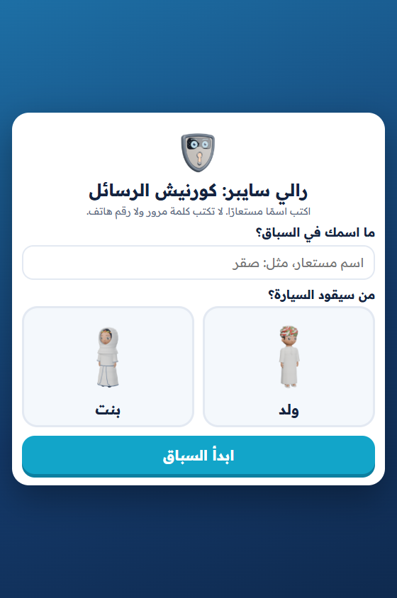
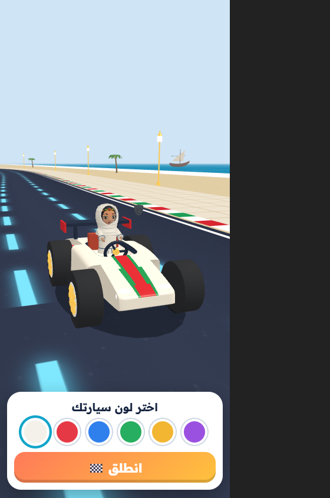
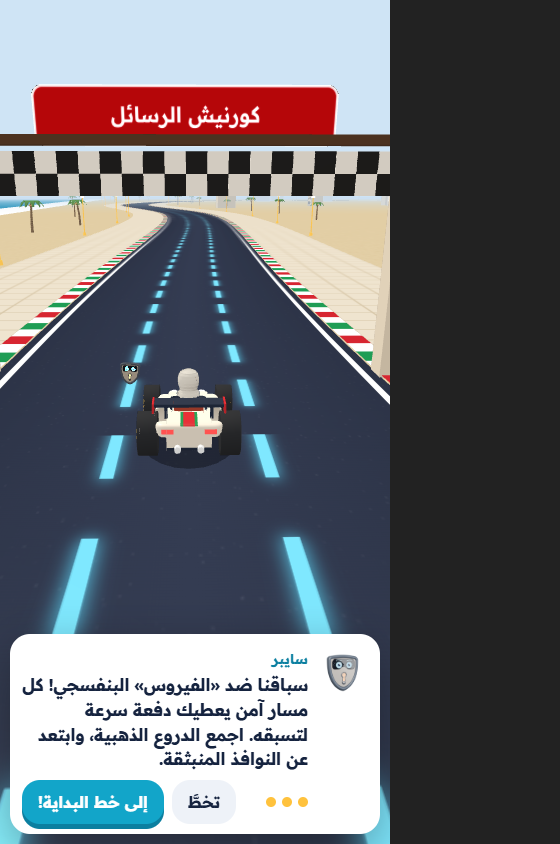
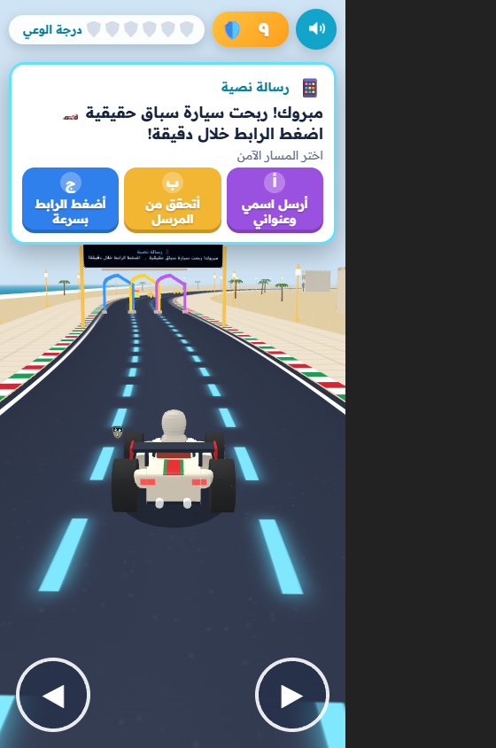
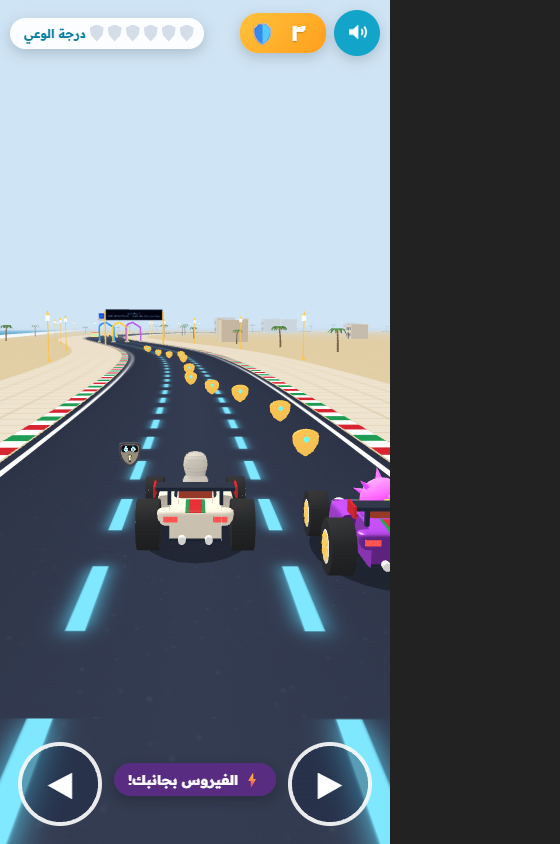
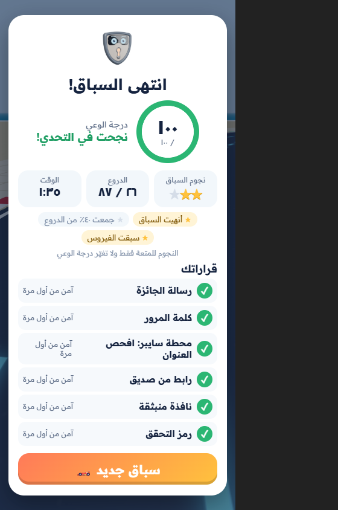

# رالي سايبر: كورنيش الرسائل 🏎️🛡️

لعبة سباق ثلاثية الأبعاد للأطفال، تعلّمهم كشف الرسائل الخادعة والاحتيال. تعمل في متصفح الهاتف أو الحاسوب، ولا تحتاج خادم ألعاب.

| | | |
|---|---|---|
|  |  |  |
|  |  |  |

## طريقة اللعب
- **قبل السباق:** يختار الطفل اسمًا مستعارًا، ويقود السيارة ولد أو بنت، ثم يختار لون السيارة، وسايبر يرافقه.
- **القيادة:** السيارة تسير وحدها، والطفل يغيّر المسار فقط بزرّي ◀ ▶ أو بلمس نصف الشاشة.
- **البوابات (5):** على كل بوابة رسالة خادعة، وتحتها ثلاثة مسارات ملوّنة. المسار الذي يدخله الطفل هو جوابه.
- **محطة سايبر:** السيارة تتوقف ويفحص الطفل رسالة على الهاتف، ويقارن عنوان المرسل بالعنوان الرسمي.
- **نتيجة الاختيار:**
  - **القرار الآمن:** دفعة سرعة، ويتعطل «الفيروس» لحظة.
  - **القرار غير الآمن:** طين يبطئ السيارة، وشرح قصير، ثم فرصة ثانية.
- **السباق ضد «الفيروس»:** سيارة بنفسجية تسابق الطفل، وتجاوزها هو الهدف.

## الدرجات
- **درجة الوعي من 100:** من القرارات فقط، وهي التي ترصدها المنصة. النجاح من 70٪، والتصحيح بعد خطأ يحسب 60٪.
- **نجوم السباق (للمتعة فقط):** ⭐ لإنهاء السباق، ⭐ لجمع 40٪ من الدروع، ⭐ للتغلب على الفيروس.

## للمطورين
- **الربط مع منصة React:** راجع [CLAUDE.md](CLAUDE.md).
- **التطوير:** `npm ci`، ثم `npm run dev`. وللاختبار `npm test`، وللبناء `npm run build`.
- **مجلد `dist/`:** جاهز للرفع مباشرة.
- **مصادر الأصول:** [ASSETS_NOTICE.md](ASSETS_NOTICE.md). ومراجعة الجودة: [docs/REVIEW_AR.md](docs/REVIEW_AR.md).

**English:** a 3D kart race for children about phishing and scams (Arabic, RTL). It is built with Vite, TypeScript and Babylon.js 8; `dist/` is a static build. See [CLAUDE.md](CLAUDE.md) for platform integration.
